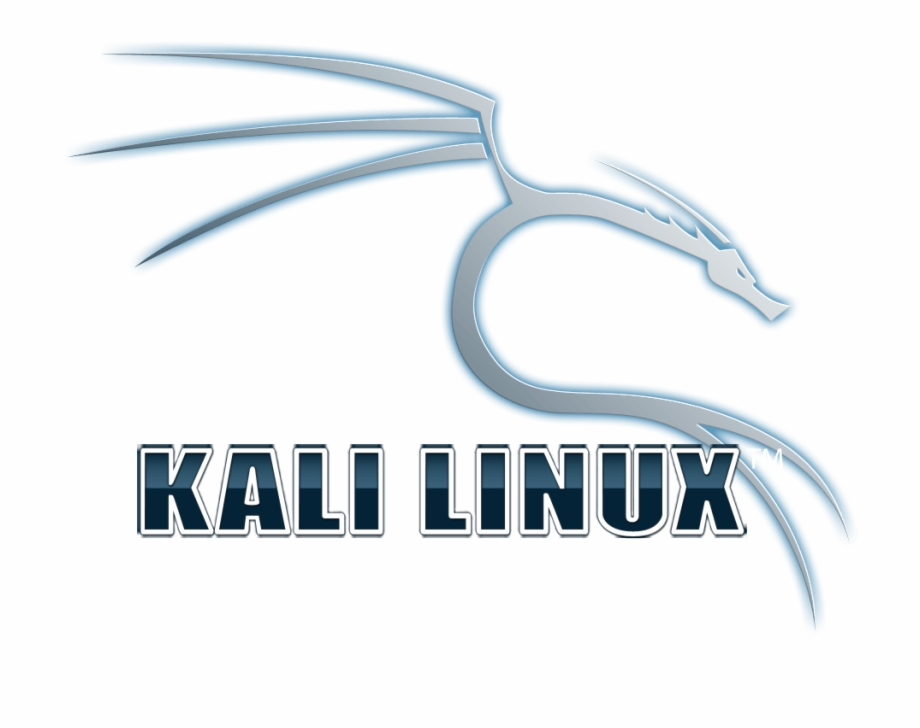

## Portfolio

### Cyber Security Analyst | Information Security Specialist | Certified Ethical Hacker

Cybersecurity Analyst / Information Security Specialist with over 5 years of professional experience in Security Operations, penetration testing, vulnerability management, incident response, endpoint security, and ISO 27001. Extensive experience with Cortex XDR, Microsoft Defender, Proofpoint, Tenable, Burp Suite, Nmap, Metasploit, and Wireshark. Certified Ethical Hacker (CEH v12) with an MSc in Web and Data Science, as well as hands-on experience in security monitoring, security assessments, and the automation of cybersecurity processes.

---

### Technical Skills:

  
  
  
  
  
  
  
  

<strong align='justify'> Burp Suite, Wireshark, Nmap, Metasploit, Python, OWASP, Khali Linux, Windows, Proxmox, C/C+, AWS Security, Tenable, Soap UI, Splunk, Microsoft Azure, CloudTrail, ISO 27001 </strong>

## Work Experience

### ⚙️ Information Security Specialist

**Information Security Specialist @ Pfenning Logistics GmbH**  
*September 2024 – Present*
- 
 Conducted an ISO 27001 gap analysis, identifying and addressing more than 20 security control gaps. 

- 
 Deployed and managed Cortex XDR on Windows and Linux endpoints and servers. Investigated security incidents and reduced incident response time by 30%.

- 
 Investigated phishing attacks and security threats using Microsoft Defender and managed employee phishing simulation campaigns through Proofpoint.

- 
 Implemented a secure password management solution on a Debian server to manage credentials for more than 50 users. 

- 
 Developed an internal security dashboard using Claude AI to centralize global security event information and improve security visibility.

### 🛡️ Master Thesis

**Development and Classification of DDoS Attack Log Dataset through Proxmox Integration and Machine Learning Algorithms**  
*June 2023 – June 2024*
- 
 Implemented a virtualized environment with ten Ubuntu Virtual Machines on Proxmox to simulate DDoS attacks. 

- 
 Generated 2.5 million records of both malicious and legitimate DDoS traffic by creating 15 types of attacks by using tools like Hping3, GoldenEye, Slowhttptest, and Ostinato. 

- 
 Captured and processed packet data using Wireshark and CICflow Meter, expanding it across 83 features in CSV format. 

- 
 Analyzed the dataset using Linear and Non-Linear machine learning algorithms like Random Forest and Logistic Regression to predict and classify the DDoS traffic patterns. 

- 
 Presented clear and actionable insights from the predictive modeling process, contributing to network security against DDoS threats. 

📊 Working Student in Data Analysis

**Working Student in Data Analysis (Internal Quality Management) @ Vaillant Group GmbH** 
*April 2023 – December 2023*
- 
 Utilized PySpark, Python, and Pandas to analyze large amounts of service data. 

- 
 Worked with a team to create and deploy use cases in the Databricks environment, resulting in a 40% improvement in data quality and efficiency. 

- 
	Automated data cleaning procedures were implemented in effect, which resulted in a 
90% reduction in data cleaning time and an increase in total data analysis productivity. 

🔍 Cybersecurity Analyst

**Cybersecurity Analyst @ Tata Consultancy Services (TCS)**
*April 2019 – November 2021*
- 
 Utilizing programs like Metasploit and Nmap, I conducted network penetration testing for customers, increasing system resilience by 35%. Delivered detailed reports and presentations to stakeholders, outlining results and recommendations. 

- 
 Executed Web Service, Mobile, Cloud, and Web Application Penetration tests using proxy tools such as Burp Suite and Soap UI, resulting in a 30% increase in vulnerability detection and mitigation. 

- 
 The network security posture of the organization increased by 20% as an outcome of the deployment of vulnerability scanners like the Tenable tool for network scanning 

- 
 Collaborated within a Center of Excellence team and obtained extensive training in SIEM, and SOC departments to demonstrate expertise in enhancing internal operations and addressing client needs effectively. 

## Projects
**Hack The Box: Headless Assessment**
- 
Conducted a comprehensive penetration test on the Headless machine from Hack The Box. Utilized various tools and techniques to identify vulnerabilities, gain access, and escalate privileges. Prepared and presented a detailed report on the findings. 

**Skills Demonstrated**
- 
 Reconnaissance and Directory Enumeration | Exploitation of XSS Vulnerabilities | Reverse Shell Execution | Privilege Escalation 

- 
 Burp Suite | Nmap | Gobuster | Python | Netcat 

**Manual Penetration Testing**
- 
Performed time-bound Manual Penetration Testing using Proxy tools like Burp Suite. <a href="https://github.com/pavankancharla26/Penetration-Testing/blob/8dd470cbae62dbd8b83570a395ea1dbc47d0878f/Penetration%20Testing%20Report.pdf">Detailed Report</a> 

- 
 Burp Suite | SQL Map | Echo | Nmap 

## Certifications
- 
 EC-Council - Certified Ethical Hacker (CEH v12) 

- 
 Certified by TCS in Hackquest 3.0(TCS Ethical Hacking contest 

## Education
- M.Sc. - Web and Data Science | University of Koblenz (_October 2021 - Present_)  |  Grade: 2.6					       		
- B.Tech. - Computer Science Engineering | Gitam University (_April2015 - May 2019_)  |  Grade: 1.8

## Languages
- English - C2 | Full Professional Proficiency
- German - B1 | Business Proficiency
